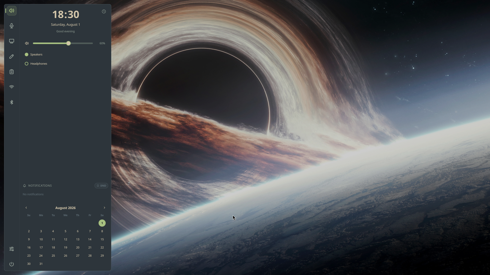

# Speshell

> Your screen is yours! Claim it back with Speshell.

A [QuickShell](https://quickshell.outfoxxed.me/) dashboard for Hyprland with no bar and no dock. It lives on a special workspace and appears on demand, even over fullscreen apps.

A personal setup first, largely built with AI. Borrow whatever is useful.

<p align="center">
  
</p>

## Features

- Clock, weather, focus timer, calendar
- Markdown notes and clipboard history
- Media (MPRIS), audio output and input
- Displays (extend or mirror) and brightness
- Network, Bluetooth, battery, power, tray
- Notifications with history and Do Not Disturb
- Launcher: apps, calculator, panels, web bangs
- Activity indicator for screen recording, dictation, and anything that publishes over IPC
- Themes with wallpapers and animated effects

Widgets for missing hardware or tools hide themselves.

## Requirements

QuickShell ≥ 0.3, Hyprland, PipeWire/WirePlumber, NetworkManager, BlueZ, libnotify.

Optional: `brightnessctl`, `curl` (weather), `hyprlock`, `cliphist`, `wl-clipboard`, `wf-recorder`, `whisper.cpp`, `xdg-utils`.

## Install

On Arch:

```bash
git clone https://github.com/vcoscrato/Speshell.git
cd Speshell
makepkg -si
```

The first run seeds `~/.config/speshell/config.ini`; upgrades never touch it or `~/.local/share/speshell`.

## Hyprland

```lua
-- Set [Appearance] panelWorkspace = special:dash to match.
local ws = "dash"

hl.bind("SUPER + GRAVE", hl.dsp.workspace.toggle_special(ws))
hl.bind("SUPER + SPACE", hl.dsp.exec_cmd("speshell launcher"))

-- Leave room for the panel: panelMargin + panelWidth + 12.
hl.workspace_rule({
    workspace = "special:" .. ws,
    persistent = true,
    gaps_in = 8,
    gaps_out = { top = 16, right = 16, bottom = 16, left = 448 },
})

hl.on("hyprland.start", function()
    hl.exec_cmd("speshell --no-duplicate --daemonize")
end)
```

## Configuration

Common options are in the dashboard's **Settings** panel. Everything else is in `~/.config/speshell/config.ini`, documented by [`config.example.ini`](config.example.ini). Edits apply on save; an invalid file keeps the previous settings and shows the error.

## Launcher

`speshell launcher [open|close|toggle]`

| Input | Result |
|---|---|
| text | Apps and panels by name, initials, or fuzzy match; web search if nothing matches |
| `2 * (8 + 4)`, `= sqrt(144)` | Calculator; Enter copies the result |
| `!network`, `!yt query` | Open a panel, or use a bang from `[Launcher.Bangs]` |
| `? query` | Search with `[Launcher] searchUrl` |
| `!theme`, `!wall` | Pick a theme or wallpaper |

Unknown bangs go to the search engine, so its own bangs work too.

## Themes

Speshell ships Cosmos (the default) and the four nations: Fire Nation, Air Nomads, Water Tribe, and Earth Kingdom. Each has a palette, a wallpaper, and launcher and wallpaper effects (see [extras/](extras/README.md)). Pick one in the **Themes** panel or with `!theme`.

Set `drawWallpaper = true` under `[Appearance]` to let Speshell draw the desktop background. It is off by default so another wallpaper tool can stay in charge.

A theme is a folder with an optional `theme.ini` and any images. Add your own under `~/.config/speshell/themes`; a folder named after a shipped theme adds wallpapers to it, and its `theme.ini` replaces the shipped one.

```ini
# ~/.config/speshell/themes/sunset/theme.ini
[Theme]
name = Sunset
effects = fire

[Colors]
base = #1d1315
text = #f3e3d3
accent = #f0702f
```

Colors use the keys of [`extras/themes/cosmos/theme.ini`](extras/themes/cosmos/theme.ini); missing ones come from Cosmos. Custom effects go in `~/.local/share/speshell/effects`.

## CLI

```bash
speshell theme list | get | set ID | shuffle [ID] | rescan
speshell wallpaper get | set PATH
speshell activity set ID STATE LABEL [DETAIL] [ICON] [TONE]
speshell activity list | clear ID
```

## Development

```bash
just lint test
just shaders   # compile effect shaders; needed once in a checkout
```

`bin/speshell` run from a checkout uses that checkout. Hardware behavior is checked by hand with [`tests/manual.md`](tests/manual.md); agent notes are in [AGENTS.md](AGENTS.md).

Icons are a subset of [Tabler Icons](https://github.com/tabler/tabler-icons) (MIT), in `assets/icons/tabler/`.
